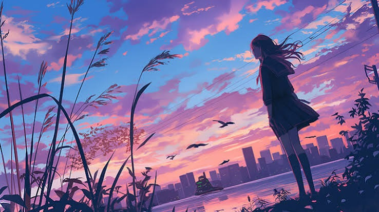

# Animated Launchers for Windows

This project builds one animated launcher per supported app — `DevinAnimated.exe`, `AntigravityAnimated.exe`, `CodexAnimated.exe`, and `ClaudeAnimated.exe` — plus `ThemeStudio.exe`, a small studio for editing themes. A theme is a wallpaper with a look (visibility, blur, dim, tint, and which part of the image stays in view) and the text of the 12-second startup animation (title, subtitle, accent color, and boot lines). All supported apps share one theme library. Each app's helper plays the animation when the app starts and keeps the artwork visible inside the app window, its taskbar hover thumbnail, and its Alt+Tab card.



## Install and launch

You'll need 64-bit Windows (x64), at least one of the supported apps (Devin, Antigravity IDE, Codex, or Claude), and Microsoft Edge WebView2 Evergreen Runtime for the animation. [WebView2 Runtime](https://developer.microsoft.com/microsoft-edge/webview2/#download)

1. Download the latest `Codex-Animated-v…-windows-x64.zip` from [Releases](https://github.com/Synaap/Codex-Animated/releases) and extract it anywhere.
2. Double-click `Install.cmd`. It copies the five executables to `%LOCALAPPDATA%\Programs\AnimatedLaunchers`, sets up the helper of each supported app it finds (the helper starts with Windows and starts now), clears the downloaded-file mark from its installed copies so Windows does not ask again at every sign-in, and adds a Start menu shortcut for Theme Studio. To turn on another app's helper later, use Theme Studio under **Apps and startup**. If you installed an earlier version, it also moves your shortcuts to the new folder.

From a clone of this repository, `Install.cmd` builds the executables first and then does the same.

Open your apps the way you always do. The animation plays whenever the app starts and its window comes to the front, whether you used its usual shortcut, the Start menu, or a launcher. It never plays when the app was already open, and an app that starts in the background does not get one. Starting an app through its launcher (`DevinAnimated.exe` and so on) opens the app at once and plays the animation on top.

Choose **Skip** or press **Esc** to dismiss the animation. The animation is also skipped when Windows requests reduced motion. To watch it by itself, pass `--preview` to a launcher executable.

## Themes and Theme Studio

Open **Theme Studio** from the Start menu or the helper's notification-area menu. The left rail lists your themes, and **New theme** imports a JPEG, PNG, or BMP.

- The preview in the middle has two views. **In the app** draws your wallpaper over a mock editor with the same look the helper uses; drag it to choose which part of the image stays in view. **Startup animation** shows the real animation page for the theme.
- The right side holds the wallpaper look (presets, visibility, blur, dim, tint, tint color) and the animation text (title, subtitle, accent color, avatar, boot lines). Leave the text empty and the animation shows your app's name.
- **Use on** puts the theme on an app. Edits save by themselves and reach every app that uses the theme right away, so there is no save button and no restart.
- **Apps and startup** sets, for each app, its theme, whether the animation plays on start, its speed, and whether its helper starts with Windows.

Deleting a theme sends it to the Recycle Bin. Apps keep their own copy of the wallpaper, so what an app shows does not change.

## While using the app

The helper draws the artwork at the selected opacity across the app window. Text and controls pick up a slight tint, and clicks pass through to the app. The artwork stays with the window when you drag, resize, maximize, or switch apps.

The helper stays in the notification area when the app closes. It reattaches when the app reopens or replaces its main window, and follows the active window if several are open.

Right-click the app's **artwork** icon in the Windows notification area (check the hidden icons if needed). Open **Theme Studio…**, pick a theme from **Themes**, choose **Hide artwork** or **Show artwork**, or turn the startup animation on or off. **Exit** closes the helper and leaves the app open.

While the artwork is visible, maximize and restore are instant for that window. Hiding the artwork or exiting the helper releases the transition setting. If Windows cannot attach the image inside the app, the helper uses a separate click-through window. In that fallback mode, Windows previews can omit the artwork.

## How it works

The helper watches for the app's window. When the app starts, the helper plays the animation, which it loads from local files in its own WebView2 session. A launcher opens the app — `Devin.exe` or `Antigravity IDE.exe` from the local install (resolved from the standard install folders and the registered protocol), Claude through the `claude.exe` that Anthropic's standard Windows installer puts in `%LOCALAPPDATA%\AnthropicClaude`, or Codex through its Microsoft Store app identity — and plays the same animation. The helper attaches the artwork through Windows window-management APIs; it verifies the window belongs to the real app — the executable path for Devin and Antigravity, a `claude.exe` inside the `AnthropicClaude` install folder for Claude (so the Claude Code command-line tool is never matched), the package family `OpenAI.Codex_2p2nqsd0c76g0` for Codex — before attaching. Everything runs locally as your Windows user, leaves the app installations intact, and opens no debugging port.

## Where data lives

- `%LOCALAPPDATA%\Animated Launchers\Themes\<name>` holds each theme: `theme.ini`, `wallpaper.jpg`, and an optional `avatar.jpg`.
- `%LOCALAPPDATA%\<App> Animated` holds one app's `settings.ini` and its own copy of the wallpaper and avatar. The helper and the animation read only this folder. With no copy, the bundled sunset is used.
- `%LOCALAPPDATA%\Animated Launchers\studio.ini` remembers where the Theme Studio window was.

## Build from source

Clone this repository or download the source archive. Open PowerShell in the repository root on x64 Windows and run the build script.

```powershell
.\source\Build.ps1
```

The script uses the 64-bit .NET Framework C# compiler and the WebView2 SDK DLLs included in the repository. It writes five executables — `DevinAnimated.exe`, `AntigravityAnimated.exe`, `CodexAnimated.exe`, `ClaudeAnimated.exe`, and `ThemeStudio.exe` — to the same folder as `web`. Each launcher is compiled from the same sources with a per-app `APP_*` define selected in `source/AppTarget.cs`. To change the animation itself, edit the files in `web` and rebuild. The Theme Studio page is in `studio`.

`.\tools\Test.ps1` builds and runs the offline tests for the look and theme logic. `.\tools\Package.ps1` builds and writes the release zip and its checksum to `dist`.

## Uninstall

Run `Uninstall.cmd`. It stops the helpers, removes their start-with-Windows entries, points shortcuts back to the native apps (or removes them), and deletes the install folder. Add `-RemoveData` to `Uninstall.ps1` to also delete your themes and settings. It asks before it changes anything, and `-WhatIf` shows what it would do without doing it.

## What's next

See [ROADMAP.md](ROADMAP.md) for the planned updates.

## Credits

The portrait startup animation is adapted from panding999’s Codex Startup Animation. The Windows adaptation uses the sunset illustration supplied for this release and traces the selected wallpaper at startup. [Upstream animation at the source revision](https://github.com/panding999/codex-startup-animation/tree/c743c2b5eceaa7be9dc511d23a1a77f7c4ce6248)

The launcher uses Microsoft.Web.WebView2 version `1.0.4314.35`. The package includes Microsoft’s [license](notices/LICENSE.txt) and [third-party notices](notices/NOTICE.txt).
